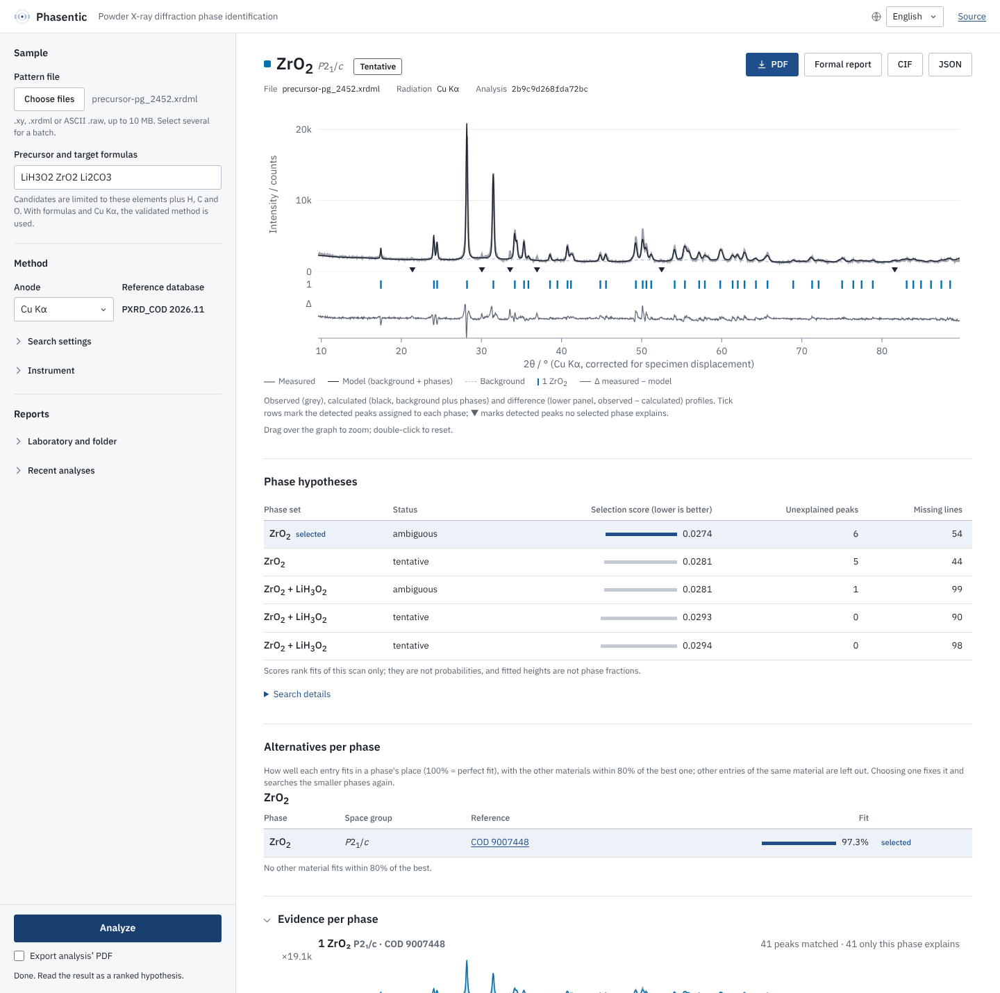

<p align="center">
  <picture>
    <source media="(prefers-color-scheme: dark)" srcset="../assets/wordmark-dark.svg">
    
  </picture>
</p>

<p align="center">
  Phasenidentifizierung mittels Pulver-Röntgendiffraktometrie mit einer validierten, reproduzierbaren Methode.
</p>

<p align="center">
  <a href="../README.md">English</a> | <a href="README_es.md">Español</a> | <a href="README_fr.md">Français</a> | <a href="README_cn.md">简体中文</a> | <a href="README_ar.md">العربية</a> | <b>Deutsch</b>
</p>

<p align="center">
  
  <a href="../LICENSE"></a>
</p>

<p align="center">
  <a href="#install">Installation</a> ·
  <a href="#quick-start">Schnellstart</a> ·
  <a href="#how-accurate-is-it">Validierung</a> ·
  <a href="../docs/">Dokumentation</a>
</p>

Phasentic liest einen Pulverdiffraktogramm-Scan (`.xy`, `.xrdml` oder ASCII-`.raw`),
erkennt die Reflexe, durchsucht eine Referenzdatenbank auf Grundlage der
[Crystallography Open Database](https://www.crystallography.net/cod/) (oder [POW_COD](https://www.ba.ic.cnr.it/softwareic/qualx/) des CNR)
und passt Gemische aus bis zu fünf Phasen an. Es liefert eine Rangfolge von
Phasenhypothesen und hält alle Einstellungen, Hashwerte und Warnungen in einem
JSON-Bericht fest. Es läuft lokal, im Browser oder auf der Kommandozeile.

<p align="center">
  
  <br>
  <sub>Ein zufällig ausgewählter Entwicklungsscan aus dem Datensatz Precursor Genome (PG_2452, Cu Kα). Phasentic wählt ZrO₂. Die manuell verfeinerte Referenzzuordnung enthält zusätzlich zwei Nebenphasen: LiOH·H₂O, das nur in den konkurrierenden Hypothesen erscheint (ZrO₂ + LiH₃O₂), und Li₂CO₃, das dieser Lauf übersieht.</sub>
</p>

<a name="how-accurate-is-it"></a>
## Wie genau ist es

Die Einstellungen wurden an 485 Scans aus Precursor Genome (manuell verfeinerte
Zuordnungen) abgestimmt und dann auf 200 gesperrte Scans angewendet, die bei der
Abstimmung nie verwendet wurden, mit der Datenbank PXRD_COD 2026.11 (aus COD,
ergänzt um Materials Project). Enthaltungen zählen als Fehler.

| Ebene | Richtig | Quote |
|---|---|---|
| Richtige Verbindungen und Kristallstrukturen (streng) | 85 / 200 | 42,5 % |
| Richtige Verbindungen, beliebiges Polymorph (Familie) | 104 / 200 | 52,0 % |

Dies ist der zweite Lauf auf diesen 200 Scans. Der erste (72 und 99) verwendete
die reine COD-Datenbank; die Datenbankergänzung, die wiederhergestellten
Wasserstoff-Formeln und die Bevorzugung der Beschreibung höchster Symmetrie
eines Materials wurden ausschließlich an den 485 Abstimmungs-Scans entwickelt.
Die nicht abgestimmte Methode erreichte 71 und 96. Diese Zahlen gelten für das
validierte Preset mit PXRD_COD 2026.11, Cu Kα und der Precursor-Chemie der
Probe; andere Einstellungen sind nicht getestet.

<a name="install"></a>
## Installation

Die Installation richtet Python 3.12, Phasentic und die Referenzdatenbank ein
(ein Download von 8,6 GB von Zenodo; etwa 10 GB frei halten).
Administratorrechte sind nicht nötig.

Windows: diese vier Zeilen in PowerShell einfügen (die erste ist der offizielle
Installer von [uv](https://docs.astral.sh/uv/), der Python installiert):

```powershell
powershell -ExecutionPolicy ByPass -c "irm https://astral.sh/uv/install.ps1 | iex"
$env:Path = "$env:USERPROFILE\.local\bin;$env:Path"
uv tool install --force --python 3.12 https://github.com/qaemu/phasentic/archive/refs/tags/v1.0.0.zip
phasentic setup
```

macOS und Linux:

```bash
curl -LsSf https://raw.githubusercontent.com/qaemu/phasentic/v1.0.0/install.sh | sh
```

Unter Windows lädt `phasentic setup` die Datenbank herunter, legt eine
Verknüpfung **Phasentic** auf dem Desktop und im Startmenü an und öffnet
Phasentic in einem eigenen Fenster; vor einer Neuinstallation Phasentic
schließen. Unter macOS fügt der Installer Phasentic zu den Programmen hinzu,
unter Linux zum Anwendungsmenü. Wird der Download unterbrochen, dieselben
Befehle erneut ausführen; er wird fortgesetzt.

### POW_COD stattdessen verwenden

Wer **POW_COD 2205 (FULL)** von der
[CNR-Downloadseite](https://www.ba.ic.cnr.it/softwareic/qualx/download/powcod-2205/)
hat, installiert es mit dem folgenden Befehl; Phasentic verwendet es dann statt
der COD-Datenbank. Die veröffentlichten Genauigkeitswerte wurden mit der
COD-Datenbank gemessen, nicht mit POW_COD.

```bash
phasentic setup-powcod ~/Downloads/powcod-2205.zip
```

<a name="quick-start"></a>
## Schnellstart

Phasentic über die Verknüpfung öffnen oder `phasentic-app` ausführen. Für die
Nutzung im Browser den folgenden Befehl ausführen und <http://127.0.0.1:8000>
öffnen:

```bash
phasentic serve
```

Einen Scan auf das Fenster ziehen (oder auswählen), die Formeln der Precursoren
und Zielphasen eingeben und *Analyze* drücken. Mit Formeln und Cu Kα wird die
validierte Methode verwendet; Reflextoleranz und maximale Phasenzahl lassen sich
unter *Search settings* ändern, andere Werte sind nicht validiert. *PDF*
speichert einen einfachen Bericht der gemessenen und berechneten Werte; *Formal
report* öffnet einen druckbaren Bericht (Anpassungsplot, Belege je Phase,
konkurrierende Hypothesen, Methode und Rückverfolgbarkeit); *CIF* und *JSON*
liefern die Daten. Die Oberfläche ist auf Englisch und Spanisch verfügbar.

Auf der Kommandozeile dieselbe validierte Methode:

```bash
phasentic analyze scan.xrdml --preset validated --chemistry "Ag2O BaCO3 Ba2Ag2C2O7" --output report.json
```

`--chemistry` beschränkt die Kandidaten auf die Elemente dieser Formeln sowie H,
C und O (Carbonate, Hydroxide, Hydrate). Ohne `--preset` lässt sich jede
Analyseeinstellung über Optionen anpassen (`phasentic analyze --help`); diese
Kombinationen sind nicht validiert.

Ergebnisse sind höchstens `tentative` (oder `ambiguous` / `unresolved`): eine
Entscheidung `supported` bräuchte eine beigefügte Kalibrierung der
Linienpositionen, die diese Version nicht anbietet. `phasentic calibrate
standard.xy` prüft weiterhin die Linienpositionen eines Geräts anhand eines
Standard-Scans (standardmäßig Silicium NIST SRM 640g).

## Wann man es nicht verwenden sollte

- **Für Phasenanteile.** Die Skalenfaktoren der Anpassung sind
  Screening-Amplituden, keine Massenanteile.
- **Für Proben mit drei oder mehr Phasen**, bei denen es im Test nur in 11 %
  der Fälle alle Verbindungen erkannte.
- **Für Neben- oder schwach streuende Phasen** (etwa Li-, B- oder K-Salze neben
  Phasen schwerer Elemente), die es oft übersieht.

## Funktionsweise

1. Scan einlesen, Untergrund schätzen, Reflexe erkennen (rauschabhängig).
2. Kandidaten aus der Referenzdatenbank abrufen, beschränkt auf die Elemente der Probe.
3. Nichtnegative Gemische von Referenzprofilen mit einer begrenzten Strahlsuche,
   erneuten Abfragen auf dem Residuum und Phasentausch anpassen; Phasen
   verwerfen, deren starke Linien im Scan fehlen.
4. Hypothesen ordnen, Mehrdeutigkeit melden und die Herkunft festhalten
   (Eingabe-Hash, Einstellungen, Identität der Datenbank, Algorithmusversionen).

Details: [docs/scientific-method.md](../docs/scientific-method.md) und
[PARAMETERS.md](../PARAMETERS.md).

## Zitieren

Wenn Phasentic zu Ihrer Arbeit beiträgt, zitieren Sie die verwendete Version.
Die Schaltfläche *Cite this repository* auf GitHub (aus
[CITATION.cff](../CITATION.cff)) liefert APA und BibTeX. Zitieren Sie außerdem
die Referenzdatenbank, [PXRD_COD 2026.11](https://doi.org/10.5281/zenodo.24059658),
und ihre Quellen: die Crystallography Open Database und das Materials Project
(und POW_COD, falls Sie es stattdessen verwenden).

## Lizenz

MIT für den Code. Die Referenzdatenbank steht unter CC BY 4.0 (COD-Daten CC0,
Materials-Project-Daten CC BY 4.0). Die Daten von POW_COD und Precursor Genome
unterliegen ihren eigenen Bedingungen und sind nicht in diesem Repository
enthalten.
